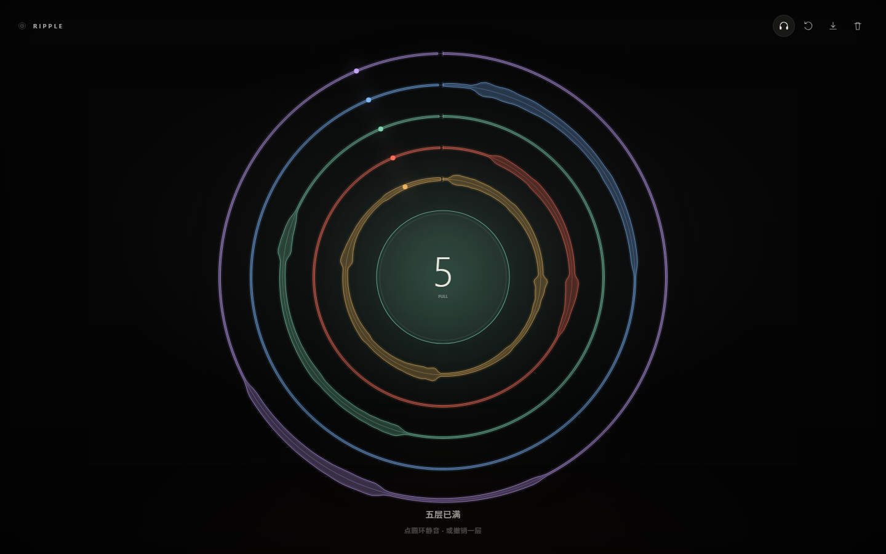
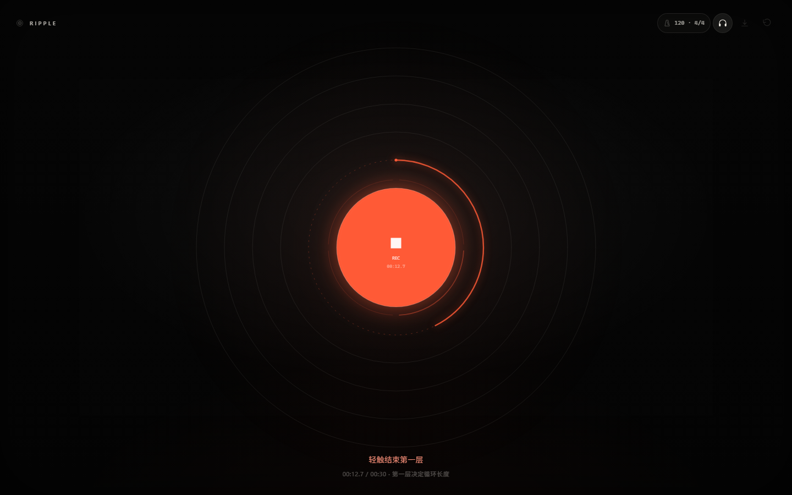
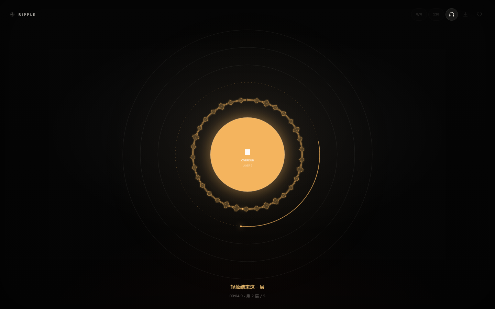
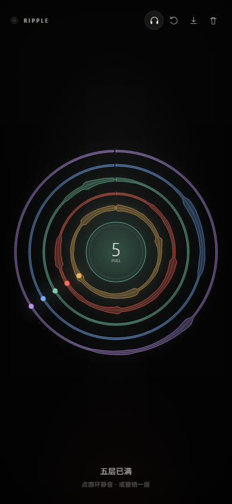

# Ripple

**一个人。一个循环。五个圆环。**

**在线演示：** https://black-ei.github.io/ripple/

Ripple 是一个单文件、零依赖的浏览器循环工作站。轻触中心开始录音，再轻触结束；声音变成一圈涟漪。之后每一次轻触都会叠加一层新的圆环。点圆环静音，点右上角带走你的现场。

它从你给的 `Ripple` 基线重做而来：保留「一个画布、一个中心、同心环、轻触开始、点环静音」的骨架，把复杂度收进音频引擎，而不是加到界面上。



---

## 打开

```bash
node serve.mjs
```

打开 **http://127.0.0.1:4173**。

无需构建、无需账号、无需上传。建议戴耳机。

> 请通过 `http://localhost` 打开，不要直接双击 `index.html`。麦克风权限与 AudioWorklet 需要 HTTP 环境。

---

## 三次轻触

1. **轻触中心**，允许麦克风，开始录第一层。  
   **再轻触**，结束录音。它立刻变成循环。
2. **再轻触中心**，在循环上叠加一层。  
   **点任意圆环**，静音 / 恢复那一层。
3. **右上角**：监听、撤销、导出 WAV、清空。  
   清空需要点两次，第二次才真正移除。

监听默认开启。戴耳机使用；如果用扬声器出现啸叫，点右上角耳机图标关闭。

没有麦克风，或浏览器拒绝权限时，界面会显示对应的错误提示。连接设备或修改权限后，再次轻触中心即可重试。

- 第一层决定循环长度，最长 30 秒
- 最多 5 层
- 第一层至少 0.6 秒，叠加层至少 0.12 秒
- `Space` 开始 / 结束 / 叠加
- `U` 撤销，`E` 导出，`1`–`5` 静音对应圆环

---

## 从基线保留了什么

- 一整块黑色画布，没有面板、没有时间线
- 中心圆 = 唯一主按钮
- 同心圆 = 声音层
- 轻触开始 / 轻触结束
- 点圆环静音
- 底部一行提示，其余全部留白

## 优化了什么

**音频**

- AudioWorklet 帧级捕获，ScriptProcessor 作为回退
- 先请求麦克风，成功后才创建 AudioContext；没有麦克风时不会触发 autoplay 警告
- 精确切片录音区间，循环长度不被 JS 定时器抖动影响
- 输入监听（默认开启）+ 输入电平驱动的中心呼吸
- Overdub 使用「预旋转 buffer」：把新录制内容放回循环相位对应的位置，再从当前相位对齐播放
- 首尾 4–5ms 淡入淡出，减少循环接缝爆音
- 主链路压缩器，限制多层叠加的峰值
- 30 秒自动停止，最短录音长度保护

**界面**

- 每层有独立颜色和真实波形圆环
- 录音时，下一圈是虚线 ghost ring，带红色录制进度弧
- 叠加时，ghost ring 变琥珀色，显示本圈录到的位置
- 播放时，中心是层数 + `LAYERS / FULL`，每圈有一个绕行的相位点
- 录音 / 叠加 / 播放三种状态有明确但克制的颜色
- 移动端安全区、触控命中、桌面/手机自适应
- 键盘快捷键与屏幕阅读器提示

**工作流**

- 最多 5 层，保持「一只手数得过来」的现场感
- 撤销最后一层
- 二次确认清空
- OfflineAudioContext 离线混音，导出 16-bit WAV
- 无麦克风时给出明确错误，轻触中心重试，而不是静默失败

---

## 技术

整个应用只有一个 `index.html`：内联 CSS + 原生 JavaScript，无框架、无打包、无外部依赖。

```
index.html                     Ripple 单文件应用
assets/ripple.svg              favicon
serve.mjs                      零依赖静态服务器
tests/ripple.test.mjs          Ripple 结构检查 + 内联脚本解析检查
docs/images/                   截图
```

### 循环时间

```
loopLen = 第一层录音时长
phase   = ((now - epoch) / loopLen) mod 1
```

每条轨道的 buffer 长度都等于 `loopLen`。新层录制时，把 PCM 从 `phaseStart` 开始写回循环时间轴，越界自动回绕：

```js
index = floor(phaseStart * loopN)
for each sample:
  layer[index % loopN] += sample
```

播放时，每条轨道的 `AudioBufferSourceNode` 都使用相同 buffer 长度，并按当前相位设置 offset，因此五层始终同步。

### 导出

`OfflineAudioContext` 重建所有未静音层，过一个与实时链路相同的压缩器，渲染成一个完整循环，再编码为 16-bit PCM WAV。

### 验证

开发时通过 Chrome DevTools Protocol + 假麦克风做了真实验证：

- 录制 2 层 / 5 层，循环长度稳定，无控制台异常
- 点圆环静音、撤销、清空、再次录音
- WAV 导出返回 RIFF/WAVE 头和正确的 PCM 字节数
- 390×844 移动端布局
- 拒绝麦克风权限后的「没有找到麦克风」提示与轻触重试路径

```bash
node --test "tests/*.test.mjs"
```

---

## 截图







---

## 浏览器

- Chrome / Edge 90+
- Safari 16.4+
- Firefox 最新版

麦克风需要安全上下文（`localhost` 或 HTTPS）。移动端建议有线耳机。

---

## 说明

以 Loop Station 工作流与刘宪华公开现场中的「一人乐队」方法为灵感。非官方项目，与艺人及设备厂商无关联。所有声音由你实时录制，没有上传。
